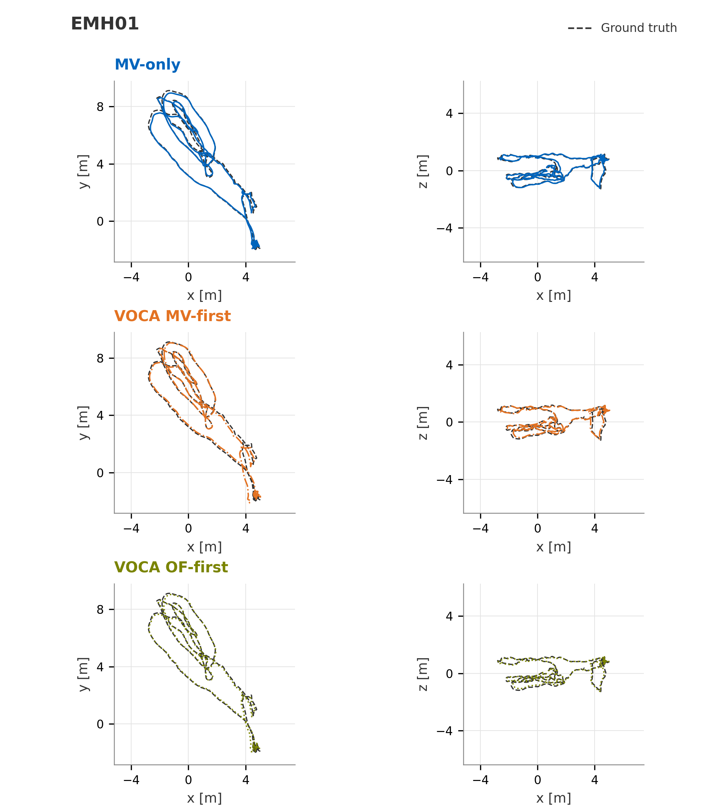

# Pixel-Free Visual Odometry

**Can video-compression motion vectors support camera tracking without pixel-based feature refinement?** This master's thesis develops and evaluates one working construction: codec-derived stereo depth and temporal correspondences feed a geometric frontend and bundle-adjustment backend.

**Emir Özer · Technical University of Munich · 2026**  
Supervisor: Mateo de Mayo · Examiner: Daniel Cremers

[Read the thesis](doc/thesis/thesis.pdf) · [Defense slides](doc/presentation/defense-slides.pdf) · [Build and run](doc/REPRODUCING.md) · [Licenses and attribution](NOTICE.md)

## Result

The method recovers useful metric trajectories from codec motion vectors on EuRoC, demonstrating the feasibility of this measurement source. The complete evaluation covers all eleven sequences; accuracy varies substantially with the scene and motion.



*MH_01_easy: codec-only odometry and the two VOCA references, each compared with ground truth. The codec-only curve is the TEASER++-only frontend ablation; it retains stereo depth and rigid-flow bundle adjustment. All views use rigid alignment without scale fitting.*

For the fixed **PVO** configuration provided in `configs/pvo.json`:

| EuRoC sequence | Absolute trajectory error | Six-frame relative translation error |
|---|---:|---:|
| MH_01_easy | 0.246 m | 0.0092 m |
| V1_01_easy | 0.226 m | 0.0189 m |
| MH_03_medium | 1.082 m | 0.0476 m |

ATE is position RMSE after one full-trajectory rotation/translation alignment. RTE-6 is translation RMSE over non-overlapping six-frame intervals. Full results, comparison methods, ablations, and failure cases are in the thesis. The selected parameters were evaluated on the same benchmark used for their selection.

## Thesis contribution

- Adapt video-encoder block predictions into stereo depth using rectification, grid phases, and disparity pre-shifts.
- Combine reciprocal temporal support, TEASER++ rigid consensus, delayed track confirmation, and age-prioritized suppression to form geometric tracks.
- Integrate codec-derived displacements into a rigid-flow bundle-adjustment formulation.
- Evaluate complete trajectories, component ablations, and the limitations of short-lived codec correspondences.

The implementation builds on [Basalt](https://gitlab.com/VladyslavUsenko/basalt), [Basalt for Monado](https://gitlab.freedesktop.org/mateosss/basalt), and the codec-aware tracking work underlying VOCA. TEASER++ supplies robust registration; the encoder-stereo idea is adapted from Passthrough+. The thesis bibliography identifies these contributions in detail.

## How it works

```text
Prepared H.264 streams
  ├─ Temporal motion-vector candidates + reverse-direction agreement
  └─ Codec stereo matching → calibrated depth at both endpoints
                     ↓
             TEASER++ rigid consensus
                     ↓
       Track association and duplicate suppression
                     ↓
          Rigid-flow bundle adjustment
                     ↓
               Camera trajectory
```

“Pixel-free” describes the geometric frontend and estimator: they consume codec metadata, calibration, masks, and timestamps. Image preparation and encoding still use pixels, and the current decoder reconstructs images internally. Full-sequence reverse encoding and two-pass rate control make the evaluated preparation offline. The work demonstrates geometric feasibility; end-to-end hardware energy savings and live operation remain deployment questions.

## Explore the implementation

| Component | Source |
|---|---|
| Stereo-stream preparation | [`.ci/get_dataset.py`](.ci/get_dataset.py) |
| Motion-vector frontend, matching and tracks | [`frame_to_frame_optical_flow.h`](include/basalt/optical_flow/frame_to_frame_optical_flow.h) |
| Robust rigid registration | [`direct_mv_rigid_registration.cpp`](src/optical_flow/direct_mv_rigid_registration.cpp) |
| Visual-odometry backend | [`sqrt_keypoint_vo.cpp`](src/vi_estimator/sqrt_keypoint_vo.cpp) |
| Optimization and landmark factors | [`src/linearization`](src/linearization), [`include/basalt/vi_estimator`](include/basalt/vi_estimator) |
| Selected settings | [`configs/pvo.json`](configs/pvo.json), [`scripts/run_pvo.sh`](scripts/run_pvo.sh) |

## Get started

```bash
git clone --recurse-submodules https://github.com/Hrshed/pixel-free-visual-odometry.git
cd pixel-free-visual-odometry
```

Follow [the build and data-preparation guide](doc/REPRODUCING.md). The code uses C++, CMake, Eigen, OpenCV, FFmpeg, and TEASER++; the thesis source uses LaTeX. Datasets and generated video streams are obtained/prepared separately.

This repository contains one finished-work snapshot on `main`, with pinned dependency submodules. [Provenance](doc/PROVENANCE.md) records the source and selected configuration. Development branches, experiment archives, downloaded papers, and generated binaries are not included. The original upstream instructions remain available in [README.upstream.md](README.upstream.md).

## License and acknowledgements

The software retains the BSD-3-Clause license and existing file-level licenses. Thesis text, figures, dataset material, and TUM branding have separate rights; see [NOTICE.md](NOTICE.md). The repository does not grant a blanket software license over those materials.

This product includes software developed by the Autonomous Systems Lab and Skybotix AG.
